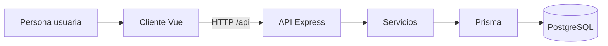

# Kordia · Monitor de hábitos grupales

Kordia es una aplicación web para organizar hábitos en grupo y seguir su cumplimiento. Cada persona puede crear un grupo o solicitar el ingreso con un código de invitación. Una vez dentro, puede participar en hábitos, registrar su cumplimiento y consultar el progreso. El grupo también cuenta con chat, historial y recordatorios.

## Arquitectura

El cliente web está construido con **Vue 3, TypeScript y Vite**. Vue Router organiza la navegación, Pinia mantiene el estado de la aplicación y Axios envía las peticiones a la API. El backend usa **Express** para recibir las peticiones y **Prisma** para leer y escribir en **PostgreSQL**.



Por ejemplo, al registrar el cumplimiento de un hábito, la vista de grupo envía un check-in a la API. Express comprueba la sesión y valida los datos de la solicitud. El controlador delega la operación al servicio de grupos, donde se verifican los permisos y se guarda el registro con Prisma. La interfaz recibe la respuesta y actualiza el progreso que muestra.

### Estructura del repositorio

```text
proyecto_web/
├── README.md
├── Dockerfile                 Compila Vue y sirve la aplicación con Express
├── render.yaml                Configuración del servicio web y PostgreSQL en Render
├── backend/                   API Express + Prisma + PostgreSQL
│   ├── server.js              Arranque HTTP, recordatorios y cierre ordenado
│   ├── docker-compose.yml     PostgreSQL 16 para desarrollo local
│   ├── prisma/                Esquema, migraciones y datos de prueba
│   ├── scripts/               Comando para ejecutar el cierre diario
│   ├── tests/                 Pruebas de autenticación y verificación de correo
│   └── src/
│       ├── app.js             Configuración de Express, CORS, rutas y errores
│       ├── config.js          Orígenes permitidos, JWT y cookies
│       ├── prisma.js          Cliente Prisma compartido
│       ├── routes/            Endpoints bajo /api
│       ├── controllers/       Reciben solicitudes HTTP y preparan respuestas
│       ├── services/          Lógica de autenticación, grupos y recordatorios
│       ├── repositories/      Consultas reutilizables de grupos y membresías
│       ├── middlewares/       Autenticación, validación, errores e ID de solicitud
│       ├── validators/        Esquemas Zod para validar solicitudes
│       └── utils/             Lectura de cookies
└── Frontend/                  Cliente Vue 3 + TypeScript + Vite
    ├── public/                Archivos estáticos públicos
    ├── tests/                 Pruebas de personajes y del cliente de autenticación
    └── src/
        ├── assets/            Imágenes y hojas de estilo
        ├── components/        Componentes reutilizables de interfaz y de grupos
        ├── composables/       Lógica reutilizable, como la cuenta regresiva diaria
        ├── layouts/           Estructuras de las pantallas públicas y privadas
        ├── views/             Inicio, acceso, grupos, calendario, perfil y ajustes
        ├── router/            Rutas y control de acceso a las vistas
        ├── stores/            Estado de sesión, grupos y personajes con Pinia
        ├── services/          Cliente Axios y llamadas a la API
        ├── types/             Tipos TypeScript de autenticación y grupos
        ├── constants/         Categorías, banners y temas
        ├── utils/             Funciones de fecha y hora
        └── mocks/             Datos de demostración
```

Usa `Frontend` con mayúscula en las rutas y los comandos.

## Funciones principales

- **Cuenta y sesión.** Registro, inicio de sesión, consulta y revocación de sesiones. El token de acceso se mantiene en memoria con Pinia. El token de renovación se envía en la cookie `refreshToken`, marcada como `HttpOnly` y limitada a `/api/auth`. Al renovar, la API rota el token de renovación.
- **Grupos.** Creación de grupos, invitaciones por código, solicitudes de ingreso y gestión de membresías. Cada persona usa su propia cuenta.
- **Hábitos y progreso.** Participación en hábitos, check-ins, notas, historial y rachas. El backend puede procesar el cierre del día anterior según la zona horaria del grupo y aplicar las penalizaciones correspondientes.
- **Chat y preferencias.** Los mensajes se guardan en PostgreSQL. El perfil también guarda el personaje y el tema por cuenta, y la configuración permite ajustar las preferencias de notificación.

## Desarrollo local

Necesitas **Node.js 22.18 o posterior dentro de la rama 22, o Node.js 24.12 o superior**, npm y Docker con Compose. Ejecuta cada bloque en una terminal distinta, empezando desde la raíz del repositorio.

### Backend

```powershell
cd backend
if (-not (Test-Path .env)) { Copy-Item .env.example .env }
npm ci
docker compose up -d --wait db
npm run db:deploy
npm run dev
```

La API usa el puerto `3000` por defecto. Comprueba que responde en `http://localhost:3000/api/health`. Si cambias las credenciales de PostgreSQL, actualiza también `DATABASE_URL` en `backend/.env`.

Si necesitas datos de prueba, configura `SEED_ADMIN_EMAIL` y `SEED_ADMIN_PASSWORD` en `backend/.env` y ejecuta `npm run db:seed` desde `backend`. La contraseña debe tener al menos 12 caracteres. El seed prepara una cuenta administradora y el grupo `HABITOS-DEMO`.

### Frontend

```powershell
cd Frontend
if (-not (Test-Path .env)) { Copy-Item .env.example .env }
npm ci
npm run dev
```

Abre `http://localhost:5173`. Vite reenvía las solicitudes de `/api` al backend local. Para probar el recorrido principal, registra dos cuentas, crea un grupo desde una de ellas y solicita el ingreso desde la otra con el código de invitación. Una vez aprobada la solicitud, registra un check-in y consulta el progreso.

### Comandos de mantenimiento

| Directorio | Comando | Uso |
| --- | --- | --- |
| `backend` | `npm test` | Ejecuta las pruebas del servidor. |
| `backend` | `npm run db:generate` | Regenera el cliente Prisma. La instalación también lo genera. |
| `backend` | `npm run db:migrate -- --name nombre_del_cambio` | Crea y aplica una migración en desarrollo. |
| `backend` | `npm run db:deploy` | Aplica las migraciones versionadas. |
| `backend` | `npm run groups:close-day` | Ejecuta el cierre diario para los grupos activos. |
| `Frontend` | `npm test` | Ejecuta las pruebas del cliente. |
| `Frontend` | `npm run build` | Verifica los tipos y genera la compilación de producción. |

## API

Estas son las rutas principales. La implementación completa está en `backend/src/routes/` y las rutas de salud y cierre diario se definen en `backend/src/app.js`.

| Método | Ruta | Acceso | Uso |
| --- | --- | --- | --- |
| `GET` | `/api/health` | Público | Comprueba que la API responde. |
| `POST` | `/api/auth/register` | Público | Registra una cuenta. |
| `POST` | `/api/auth/login` | Público | Inicia sesión y emite los tokens. |
| `POST` | `/api/auth/verify-email` | Token de verificación | Confirma el correo de la cuenta configurada para verificación. |
| `POST` | `/api/auth/resend-verification` | Correo y contraseña | Solicita otro enlace para esa cuenta. |
| `POST` | `/api/auth/refresh` | Cookie | Renueva la sesión. |
| `POST` | `/api/auth/logout` | Cookie | Cierra la sesión actual. |
| `POST` | `/api/auth/logout-all` | Bearer | Revoca todas las sesiones de la cuenta. |
| `GET` | `/api/auth/me` | Bearer | Devuelve los datos del token de acceso. |
| `GET`, `PATCH` | `/api/profile/preferences` | Bearer | Consulta o actualiza el personaje y el tema. |
| `GET`, `POST` | `/api/groups` | Bearer | Lista los grupos de la cuenta o crea uno. |
| `POST` | `/api/groups/join-requests` | Bearer | Solicita ingreso con un código de invitación. |
| `PUT` | `/api/groups/:groupId/habits/:habitId/check-in` | Bearer | Registra el cumplimiento de un hábito. |
| `POST` | `/api/groups/:groupId/messages` | Bearer | Envía un mensaje al grupo. |

### Verificación de correo y cierre diario

La verificación está habilitada para la cuenta indicada por `DEMO_EMAIL`. El resto de las cuentas puede iniciar sesión sin confirmar el correo. Para probar la verificación local, configura `DEMO_EMAIL` con la dirección de prueba, `VERIFICATION_EMAIL_MODE=console` y `APP_PUBLIC_URL=http://localhost:5173`. Después del registro, abre el enlace que aparece en la terminal del backend. Para enviar correos desde el despliegue, configura `APP_PUBLIC_URL` con la URL pública HTTPS, `RESEND_API_KEY` y `EMAIL_FROM` con un remitente autorizado, por ejemplo `Kordia <cuentas@tu-dominio.com>`.

Para programar el cierre diario, un programador externo puede invocar `POST /api/internal/close-group-day` con el encabezado `Authorization: Bearer <secreto>`. El valor debe coincidir con `DAILY_CLOSURE_SECRET` en el backend. El Blueprint de Render define el servidor web y la base de datos. El programador se configura por separado.

## Despliegue y acceso compartido

El `Dockerfile` compila Vue y Express sirve los archivos resultantes junto con la API bajo el mismo dominio. Al arrancar, el contenedor aplica las migraciones de Prisma antes de iniciar el servidor. El Blueprint de Render conecta el servicio web con una instancia PostgreSQL y comprueba la disponibilidad con `/api/health`.

Para compartir la aplicación, todas las personas deben abrir la misma URL publicada. Cada una crea su propia cuenta y usa el código del grupo para solicitar el ingreso. Las cuentas y los grupos de una base local pertenecen a esa instalación. En el despliegue, los datos se guardan en la base configurada para el servicio publicado.

Si el frontend y la API se alojan en orígenes separados, configura `VITE_API_URL` con la URL completa de la API, incluido `/api`, y agrega el origen del cliente a `CORS_ORIGINS`. Cuando el navegador los trata como sitios distintos, las cookies requieren HTTPS y `COOKIE_SAME_SITE=none`.
